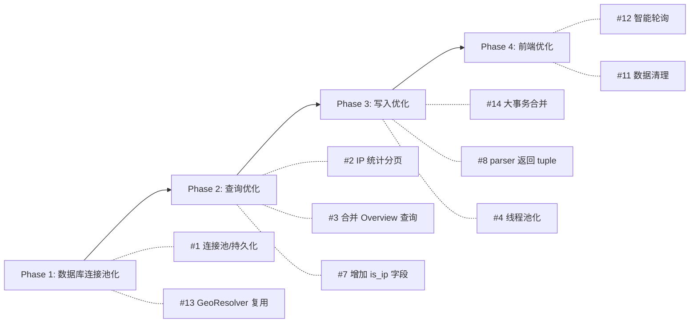

# V2Ray Log Analyzer — 性能优化分析报告

## 项目概况

该项目是一个 V2Ray 日志分析系统，由 FastAPI + SQLite + Vue.js 前端组成，部署在 PVE/Docker 环境中。当前日志量约 5 天 ~13 万行，数据库约 28MB。

> [!NOTE]
> 整体代码架构清晰、模块分离合理，已具备增量扫描、批量插入、WAL 模式等基础优化。以下分析聚焦**当日志量增长到百万级/千万级**时将暴露的性能瓶颈。

---

## 🔴 严重问题（High Priority）

### 1. 数据库连接：每次操作都新建连接 + 重设 PRAGMA

**文件**: [database.py](file:///Users/rong/Documents/PVE/v2ray_log/app/database.py#L26-L43) / [geo.py](file:///Users/rong/Documents/PVE/v2ray_log/app/geo.py#L24-L36)

每次调用 `get_connection()` 都会：
1. 创建新的 `sqlite3.connect()`
2. 执行 4 条 PRAGMA 语句
3. 用完后 `conn.close()`

在 `get_overview_stats()` 一次 API 调用中就会执行 **7+ 条 SQL 查询**，意味着产生 7+ 次连接开销。`get_ip_info()` 在 `/api/stats/ips` 中被循环调用，每个 IP 产生 2 次连接（geo cache + alias），如果有 100 个 IP，就是 200+ 次连接创建。

**建议**：引入**连接池**（或至少持久化连接 + 线程局部存储 `threading.local()`），PRAGMA 只在连接首次创建时执行一次。

---

### 2. `get_all_ips_stats()` — 全表扫描无分页

**文件**: [database.py](file:///Users/rong/Documents/PVE/v2ray_log/app/database.py#L254-L275)

```sql
SELECT client_ip, COUNT(*), SUM(CASE WHEN date = ? ...), MIN(timestamp), MAX(timestamp)
FROM access_logs
GROUP BY client_ip
ORDER BY today_count DESC, total_count DESC
```

这是一个**全表 GROUP BY** — 没有 WHERE 条件、没有 LIMIT。当数据量达到百万行时，每次 API 调用都要扫描全表进行聚合，耗时可达数秒。同时 API 层 ([api.py L60-67](file:///Users/rong/Documents/PVE/v2ray_log/app/api.py#L60-L67)) 还会对结果逐个调用 `geo.get_ip_info()`，进一步放大延迟。

**建议**：
- 添加分页（LIMIT/OFFSET）
- 或基于指定 `date` 筛选后再 GROUP BY
- 使用预计算/物化视图缓存热点数据

---

### 3. `get_overview_stats()` — 7 次独立 SQL 查询，多次全日扫描

**文件**: [database.py](file:///Users/rong/Documents/PVE/v2ray_log/app/database.py#L142-L252)

对同一天的数据执行了 **7 条独立查询**，每条都带 `WHERE date = ?`。虽然有 `idx_logs_date_time` 索引，但重复扫描同一范围 7 次仍然有大量冗余 I/O。

**建议**：将部分查询合并，或使用单次扫描 + 应用层聚合。例如 summary + hourly + protocol + outbound 可以合并为一次扫描。

---

### 4. GeoResolver 对每个 IP 发起独立线程查询

**文件**: [geo.py](file:///Users/rong/Documents/PVE/v2ray_log/app/geo.py#L99)

```python
threading.Thread(target=self._resolve_ip_background, args=(ip,), daemon=True).start()
```

如果 10 个新 IP 同时出现，会创建 10 个线程，每个线程各自建立 HTTP 连接调用外部 API。线程数不受限制。

**建议**：使用 `ThreadPoolExecutor(max_workers=3)` 替代裸线程，控制并发数量和资源消耗。

---

## 🟡 中等问题（Medium Priority）

### 5. `search_logs()` 的 `COUNT(*)` 分页性能

**文件**: [database.py](file:///Users/rong/Documents/PVE/v2ray_log/app/database.py#L381-L383)

```sql
SELECT COUNT(*) AS total FROM access_logs {where_clause}
```

当无筛选条件时（例如 `where_clause` 为空），这是一次全表 COUNT 扫描。百万行时每次翻页都要先做一次全量统计。

**建议**：
- 无筛选时使用 SQLite 的 `max(rowid)` 估算
- 或缓存 total count 结果，短时间内复用

---

### 6. `target_host LIKE '%xxx%'` 模糊搜索无法用索引

**文件**: [database.py](file:///Users/rong/Documents/PVE/v2ray_log/app/database.py#L369-L370)

```python
conditions.append("target_host LIKE ?")
params.append(f"%{target_host}%")
```

前缀 `%` 使索引失效，百万行时模糊搜索将非常慢。

**建议**：
- 改为前缀匹配 `target_host LIKE 'xxx%'`（去掉前导 `%`）
- 或使用 SQLite FTS5 全文检索

---

### 7. `GLOB` 表达式区分域名和 IP 效率较低

**文件**: [database.py](file:///Users/rong/Documents/PVE/v2ray_log/app/database.py#L208)

```sql
WHERE date = ? AND NOT (target_host GLOB '[0-9]*.[0-9]*.[0-9]*.[0-9]*' OR target_host GLOB '*:*')
```

每行都要做两次 GLOB 模式匹配，大数据量下开销不小。

**建议**：在 `access_logs` 表中增加一个 `is_ip INTEGER DEFAULT 0` 字段，写入时由 parser 判断，查询时直接 `WHERE is_ip = 0`，用整数比较替代字符串 GLOB。

---

### 8. parser 每行创建一个 dict 对象

**文件**: [parser.py](file:///Users/rong/Documents/PVE/v2ray_log/app/parser.py#L86-L97)

每行日志解析后创建一个 10 字段的 dict，进入 batch 后又转为 tuple（[database.py L89-103](file:///Users/rong/Documents/PVE/v2ray_log/app/database.py#L89-L103)）。中间经历 dict → tuple 转换，百万行时产生大量临时对象。

**建议**：`parse_line()` 直接返回 `tuple` 或 `namedtuple`，减少内存分配和 GC 压力。

---

### 9. `import re` 但从未使用

**文件**: [parser.py](file:///Users/rong/Documents/PVE/v2ray_log/app/parser.py#L1)

`import re` 未被使用，属于残留代码。影响很小但应清理。

---

### 10. 日志文件 mtime 比较存在精度问题

**文件**: [collector.py](file:///Users/rong/Documents/PVE/v2ray_log/app/collector.py#L50)

```python
if record and record.get("last_mtime") == stat.st_mtime and ...
```

浮点数 `==` 比较在跨文件系统（NFS、Docker volume）时可能因精度差异失效，导致不必要的重复导入。

**建议**：用 `abs(a - b) < 0.001` 做近似比较，或直接依赖 offset + size 判断。

---

## 🟢 低优先级优化建议

### 11. 无数据清理/归档机制

当前所有日志数据永久存储在单表中。随着时间推移，数据库持续膨胀，查询性能线性下降。

**建议**：
- 增加按月/季度自动清理旧数据的 API 或定时任务
- 或增加 `date` 分区策略（如分表，不过 SQLite 不原生支持）

---

### 12. 前端 15 秒轮询

**文件**: [app.js](file:///Users/rong/Documents/PVE/v2ray_log/static/app.js#L439-L443)

```js
setInterval(() => {
    if (activeTab.value === 'overview' && !syncing.value) {
        fetchOverview();
    }
}, 15000);
```

每 15 秒触发一次 `get_overview_stats()`（即 7 条 SQL），即使没有新数据也会查询。

**建议**：
- 后端增加 `/api/last-updated` 轻量接口，返回最近同步时间戳
- 前端先查此接口，有变化再拉全量数据
- 或使用 SSE / WebSocket 推送

---

### 13. GeoResolver 使用独立连接管理，与 Database 重复

**文件**: [geo.py](file:///Users/rong/Documents/PVE/v2ray_log/app/geo.py#L24-L36)

`GeoResolver` 自己实现了 `_get_connection()`、PRAGMA 设置等，与 `Database` 类完全重复。它们连接的是同一个 db 文件，却各自管理连接。

**建议**：让 `GeoResolver` 复用 `Database` 的连接管理，减少重复代码和连接竞争。

---

### 14. `insert_logs_batch` 事务粒度可优化

**文件**: [collector.py](file:///Users/rong/Documents/PVE/v2ray_log/app/collector.py#L71-L73)

每 5000 行一次 batch insert + commit。如果某个大文件有 10 万行，会产生 20 次事务提交。

**建议**：
- 对整个文件使用单次事务（`BEGIN ... COMMIT`），中间的 `executemany` 不要每次都 commit
- 配合 `PRAGMA synchronous = NORMAL`，单次大事务的写入速度比多次小事务快 5-10x

---

## 📊 优化实施状态与矩阵

| 优先级 | 编号 | 问题 | 收益 | 状态 |
|:---:|:---:|---|---|:---:|
| 🔴 | 1 | 每次操作新建连接 | ⭐⭐⭐⭐⭐ | ✅ 已实施 (Phase 1) |
| 🔴 | 2 | IP 统计全表扫描无分页 | ⭐⭐⭐⭐⭐ | ✅ 已实施 (Phase 1) |
| 🔴 | 3 | Overview 7 次独立查询 | ⭐⭐⭐⭐ | ✅ 已实施 (Phase 1) |
| 🔴 | 4 | 无限制线程创建 | ⭐⭐⭐⭐ | ✅ 已实施 (Phase 1) |
| 🟡 | 5 | COUNT(*) 全表统计 | ⭐⭐⭐ | ✅ 已实施 (Phase 2) |
| 🟡 | 6 | LIKE '%xxx%' 模糊搜索 | ⭐⭐⭐ | ✅ 已实施 (Phase 2) |
| 🟡 | 7 | GLOB 字符串匹配 (加 is_ip 列) | ⭐⭐⭐ | ✅ 已实施 (Phase 2) |
| 🟡 | 8 | dict→tuple 冗余转换 (直出 tuple) | ⭐⭐ | ✅ 已实施 (Phase 2) |
| 🟡 | 9 | 未使用的 import | ⭐ | ✅ 已实施 (Phase 2) |
| 🟡 | 10 | mtime 浮点比较容差 | ⭐⭐ | ✅ 已实施 (Phase 2) |
| 🟢 | 11 | 无数据清理机制 (保留6个月/180天) | ⭐⭐⭐ | ✅ 已实施 (Phase 3) |
| 🟢 | 12 | 前端无脑轮询 | ⭐⭐⭐ | 待实施 (Phase 3) |
| 🟢 | 13 | GeoResolver 重复连接管理 | ⭐⭐ | ✅ 已实施 (Phase 1) |
| 🟢 | 14 | 批量插入单文件大事务 | ⭐⭐⭐ | ✅ 已实施 (Phase 2) |

---

## 建议实施顺序



> [!IMPORTANT]
> **最高 ROI 的三项改动**：连接池化（#1）、IP 统计分页（#2）、事务合并（#14）。这三项只需少量改动就能在大数据量下获得数量级的性能提升。
